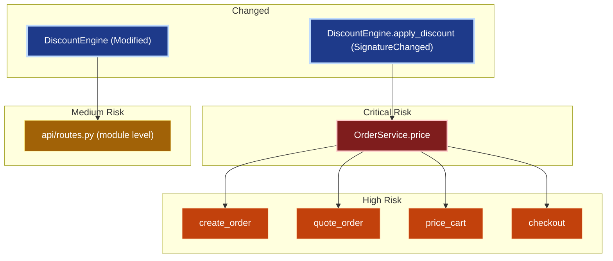

# PR Blast Radius Analyzer

> **Visualize the impact of code changes with deterministic static analysis, plus optional LLM-written explanations**

[](https://opensource.org/licenses/MIT)
[](./go-core)
[](./py-orchestrator)
[](https://pr-blast-radius.vercel.app)

A **polyglot static analysis tool** that computes the "blast radius" of code changes — which downstream symbols could break when you modify a function signature, refactor a class, or update shared utilities.

**Key Innovation:** The LLM **never decides anything Go already computed**. Go performs deterministic AST parsing, dependency resolution and severity scoring; Python builds the whole diagram from that output (nodes, labels, risk tiers, grouping, edges). The LLM only writes short narratives for nodes that are already placed, and Pydantic rejects any narrative that names an unknown node or cites a risk reason Go did not compute.

## Quick Start

### Option 1: Try the Web Demo

**👉 [Live Demo](https://pr-blast-radius.vercel.app)**: No installation required!

### Option 2: Install from Source

```bash
# Clone the repository
git clone https://github.com/yourusername/pr-blast-radius
cd pr-blast-radius

# Build the Go binary
cd go-core && go build -o ../bin/blastradius ./cmd/blastradius
cd ..

# Install Python dependencies
cd py-orchestrator
pip install -e .
cd ..

# Run analysis
python -m orchestrator.cli scan \
  --repo ./examples/tinyshop \
  --diff WORKING_TREE \
  --go-binary ./bin/blastradius \
  --verbose
```


## How It Works

```ini
┌─────────────────────────────────────────────────────────────┐
│  Phase A: Static Analysis (Go) — 100% Deterministic         │
├─────────────────────────────────────────────────────────────┤
│  1. Git diff extraction (go-git)                            │
│  2. Tree-sitter AST parsing (Go + Python grammars)          │
│  3. Symbol table construction                               │
│  4. Confidence-scored edge resolution (R1-R7, P1-P8 rules)  │
│  5. Reverse BFS traversal (cycle-safe)                      │
│  6. Severity scoring (distance + confidence + fan-in)       │
└─────────────────────────────────────────────────────────────┘
                           ▼
┌─────────────────────────────────────────────────────────────┐
│  Phase B: Visualization (Python) — Deterministic            │
├─────────────────────────────────────────────────────────────┤
│  7. spec_builder: nodes, labels, tiers, subgraphs, edges    │
│     (tier = fixed cutoffs on Go's severity score, set from  │
│      the score's reachable range — see Risk Tiers below)    │
│  8. LLM writes narratives only (Pydantic NarrativeSpec;     │
│     unknown node or invented reason → retry → template)     │
│  9. Deterministic compiler: spec → Mermaid syntax           │
│  10. Output: Markdown + SVG (via mmdc if installed)         │
│                                                             │
│  Narratives: Gemini → Ollama → Template (always wins)       │
└─────────────────────────────────────────────────────────────┘
```

### Why This Architecture?

| Traditional Approach | **This Repo's Approach** |
|---------------------|-----------------|
| LLM guesses dependencies via prompt | Tree-sitter parses AST (100% accurate) |
| LLM writes Mermaid syntax (breaks often) | Diagram built in code; LLM writes validated narratives only |
| LLM decides what looks risky | Risk tiers are fixed cutoffs on Go's severity score |
| No confidence scores | Every edge has 0.0-1.0 confidence |
| Fabricates edges when uncertain | Unresolvable calls → zero edges (logged) |


## Example Output

### Before: Making a Change

```python
# services/pricing/discount_engine.py
def apply_discount(self, base_price: Money, customer_tier: str) -> Money:
    # ... pricing logic
```

### After: Adding a Parameter

```python
def apply_discount(self, base_price: Money, customer_tier: str, currency: str = "USD") -> Money:
    # Signature changed!
```

### Analysis Result

TinyShop's call chain is Python-only. Four handlers reach pricing through the
same method:

```ini
POST /orders    create_order ┐
POST /quote     quote_order  ├─→ orders.price() ─→ self.pricing.apply_discount()
POST /cart      price_cart   │
POST /checkout  checkout     ┘

GET /inventory/<sku>  reserve_stock ─→ inventory.reserve()     (independent)
```

Actual output (`make demo DEMO_LLM=none`). The structure is identical with
`--llm gemini`; only the impact notes are worded differently.



**Impact notes** (written to `impact.md` under the diagram):

- **DiscountEngine (Modified)** [changed]: Changed in this diff (Modified). 1 direct caller in the blast radius. _(Modified)_
- **DiscountEngine.apply_discount (SignatureChanged)** [changed]: Changed in this diff (SignatureChanged). 1 direct caller in the blast radius. _(SignatureChanged)_
- **OrderService.price** [critical]: Reached at distance 1 from the change. Flagged: public_api. _(public_api)_
- **create_order** [high]: Reached at distance 2 from the change. Flagged: is_route_handler, public_api. _(is_route_handler, public_api)_
- **quote_order** [high]: Reached at distance 2 from the change. Flagged: is_route_handler, public_api. _(is_route_handler, public_api)_
- **price_cart** [high]: Reached at distance 2 from the change. Flagged: is_route_handler, public_api. _(is_route_handler, public_api)_
- **checkout** [high]: Reached at distance 2 from the change. Flagged: is_route_handler, public_api. _(is_route_handler, public_api)_

**Why those tiers** — scores come from Go, cutoffs from `spec_builder.py`
(critical 0.5 / high 0.35 / medium 0.2):

| node | distance | in-degree | score | tier |
|------|---------:|----------:|------:|------|
| `OrderService.price` | 1 | 4 (graph max) | **0.6150** | critical |
| `create_order` | 2 | 0 | 0.3967 | high |
| `quote_order` | 2 | 0 | 0.3967 | high |
| `price_cart` | 2 | 0 | 0.3967 | high |
| `checkout` | 2 | 0 | 0.3967 | high |
| `api/routes.py (module level)` | 1 | 0 | 0.2750 | medium |

`OrderService.price` outranks the handlers because it is the one chokepoint all
four go through: it carries the graph's maximum fan-in **and** sits at distance
1. The handlers are route handlers (+0.20 each) but have no fan-in of their
own. That ordering falls out of the weights; nothing is tuned per node.

Notes on the rest of the graph:

- All edges are solid: `self.pricing` is typed from `pricing: DiscountEngine`
  (0.9) and `orders` from its constructor (0.8), both above the 0.6 dashed
  threshold.
- `api/routes.py (module level)` is the module-level wiring that constructs
  `DiscountEngine()`; the diff marks the `DiscountEngine` class Modified, so
  that call site is affected too.
- The inventory branch (`reserve_stock`, `InventoryService.reserve`) is **not**
  affected — it is the untouched control in the fixture.

## Usage Tutorial

### 1. Analyze Uncommitted Changes

```bash
# Make a change to your code (don't commit it)
vim src/my_service.py

# Run analysis on working tree diff
python -m orchestrator.cli scan \
  --repo . \
  --diff WORKING_TREE \
  --llm auto  # Tries Gemini → Ollama → Template
```

**Output:**

```ini
Rendered via: template-only (1 attempt(s), degraded=False)
Output: ./blast-radius-output/impact.md
Diagram: ./blast-radius-output/impact.svg

6 nodes affected, max depth 3, 6 edges traversed.
```

If the diff deletes a tracked file, a warning follows: a deleted file has no
symbols on disk, so nothing in it can be scored or traced to its callers.

```ini
Warning: deleted file(s) not analyzed (no symbols in the current graph): services/legacy_pricing.py
```

### 2. Analyze a Commit Range

```bash
# Compare two branches
python -m orchestrator.cli scan \
  --repo . \
  --diff main...feature-branch

# Compare last 3 commits
python -m orchestrator.cli scan \
  --repo . \
  --diff HEAD~3..HEAD
```

### 3. Use Different LLM Providers

**Gemini (free tier, best quality):**

```bash
export GEMINI_API_KEY="your-key-here"  # Get from https://aistudio.google.com/apikey
python -m orchestrator.cli scan --repo . --diff WORKING_TREE --llm gemini
```

**Ollama (local, private):**

```bash
# Start Ollama server
ollama serve

# Run analysis
python -m orchestrator.cli scan --repo . --diff WORKING_TREE --llm ollama
```

**Template-only (no LLM, guaranteed to work):**

```bash
python -m orchestrator.cli scan --repo . --diff WORKING_TREE --llm none
```

### 4. Customize Traversal Depth

```bash
python -m orchestrator.cli scan \
  --repo . \
  --diff WORKING_TREE \
  --max-depth 5 \          # Traverse up to 5 layers (default: 3)
  --verbose                # Show debug logs
```

## Architecture

### Go Engine (`go-core/`)

**Responsibilities:** All ground-truth analysis

```ini
internal/
├── astparse/          # Tree-sitter parsers (Go + Python)
│   ├── go_parser.go   # Extracts symbols/imports/calls from Go AST
│   ├── python_parser.go
│   └── queries/       # Tree-sitter query files (.scm)
├── gitdiff/           # Git diff extraction (go-git + custom line-diff)
├── graph/
│   ├── symboltable.go # Two-pass indexing (files → symbols → edges)
│   ├── resolver.go    # Confidence-scored resolution (R1-R7, P1-P8)
│   ├── traversal.go   # Reverse BFS with cycle detection
│   └── mapping.go     # Hunks → changed symbols (line overlap)
├── severity/          # Severity = f(distance, confidence, fan-in, tags)
├── cache/             # SQLite content-hash cache
└── mcpserver/         # MCP server (stdio protocol)
```

**Resolution Rules:**

- **R1**: Direct function call → 1.0 confidence
- **R4**: Interface dispatch → 0.4 per implementer (Go)
- **P5**: Duck-typed ambiguity → 0.3 shared across candidates (Python)
- **R7**: Unresolvable → **zero edges** (never fabricates)

### Severity Scoring and Risk Tiers

Go scores every affected node with a fixed weighted sum:

```ini
severity_score = 0.35 * 1/(1 + distance)      # closeness to the change
               + 0.35 * normalized(in_degree)  # fan-in, relative to the graph max
               + 0.20 * is_route_handler
               + 0.10 * confidence_of_weakest_edge_on_path
```

Python then buckets that score into a risk tier. **The tier cutoffs are
calibrated against the score's reachable range, not against `[0, 1]`.** An
affected node is always at distance ≥ 1 — distance 0 is a changed root, which
is never scored, so the distance term can never exceed half its weight, and
the real ceiling is:

| node | max reachable score (distance ≥ 1) |
|------|-----------------------------------|
| route handler | **0.825** |
| any other node | **0.625** |

The cutoffs are therefore **critical 0.5 / high 0.35 / medium 0.2**, defined
once as `CRITICAL_CUTOFF` / `HIGH_CUTOFF` / `MEDIUM_CUTOFF` in
`spec_builder.py`. Cutoffs chosen as if the score spanned `[0, 1]` make the top
tier unreachable: at 0.7, no non-route node could ever be critical.

`severity.MaxReachableScore` in Go derives the ceiling from the weights, and
`tests/test_risk_tiers.py` re-derives it from those same weights and fails if a
cutoff no longer fits under it — so retuning the weights cannot silently leave
a dead tier behind.

### Python Orchestrator (`py-orchestrator/`)

**Responsibilities:** Orchestration + visualization only

```ini
orchestrator/
├── mcp_client.py      # MCP client (calls Go engine)
├── pipeline.py        # 8-stage state machine
├── spec_builder.py    # Deterministic diagram: tiers, labels, grouping, edges
├── models/
│   ├── graph_types.py # Pydantic mirrors of Go JSON output
│   └── mermaid_ir.py  # MermaidDiagramSpec + NarrativeSpec (LLM output) with validation
├── llm/
│   ├── resolve.py     # 3-tier fallback (Gemini → Ollama → Template)
│   ├── gemini_provider.py
│   ├── ollama_provider.py
│   └── template_provider.py  # Deterministic narratives (always works)
├── render.py          # compile_mermaid: spec → text
└── cli.py             # Typer entrypoint
```

**Pipeline Stages:**

1. `extract_changes` — MCP: get_changed_symbols
2. `build_graph` — MCP: get_dependency_graph
3. `compute_blast_radius` — MCP: compute_blast_radius
4. `fetch_top_n_source` — MCP: get_symbol_source (for context)
5. `resolve_llm_provider` — Gemini → Ollama → Template
6. `generate_diagram_spec` — spec_builder builds the diagram; the LLM adds narratives (validated, retried, template fallback)
7. `compile_mermaid` — spec → Mermaid text
8. `render_outputs` — Write .md + .svg

## Testing

### Run Go Tests

```bash
cd go-core
go test ./... -v

# Including integration test (requires TinyShop fixture)
go test ./cmd/blastradius -run TestFullPipeline
```

### Run Python Tests

```bash
cd py-orchestrator
pip install -e ".[dev]"
pytest -v

# 70 tests covering:
# - Deterministic spec builder: tiers, labels, edges, LLM can't change
#   structure or risk_reasons (24 tests)
# - Pipeline state machine, retries and fallback (14 tests)
# - Risk tier cutoffs vs. the severity score's reachable range (11 tests)
# - Mermaid compiler (10 tests)
# - LLM fallback chain (4 tests)
# - Env/config: Ollama, .env, cache path (4 tests)
# - Go JSON contract and graph types (3 tests)
```

### Test Coverage

- **Go:** All internal packages have unit tests + 1 integration test
- **Python:** 52/52 passing (spec builder, pipeline, LLM fallback, Mermaid compiler)
